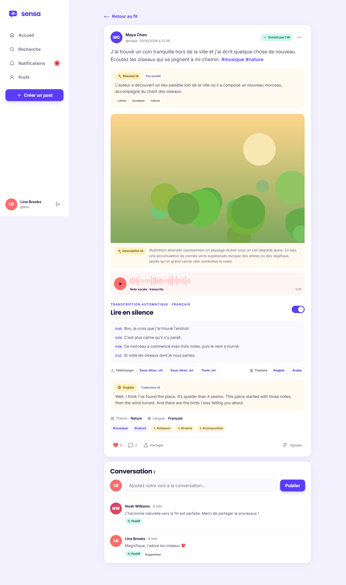
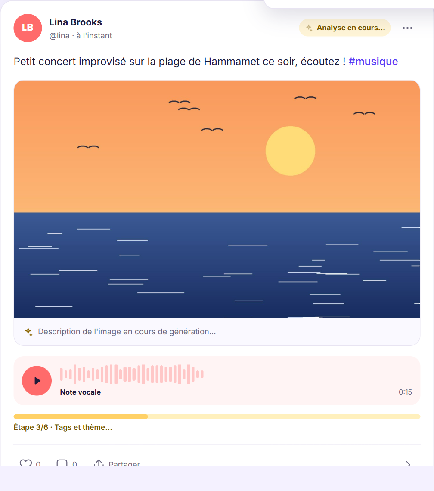
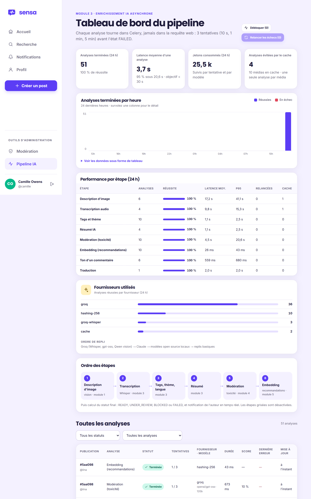
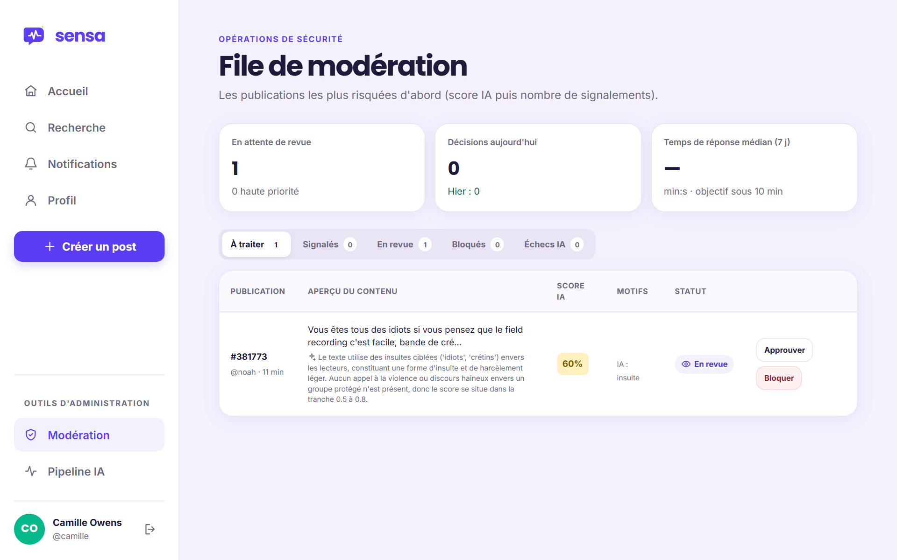
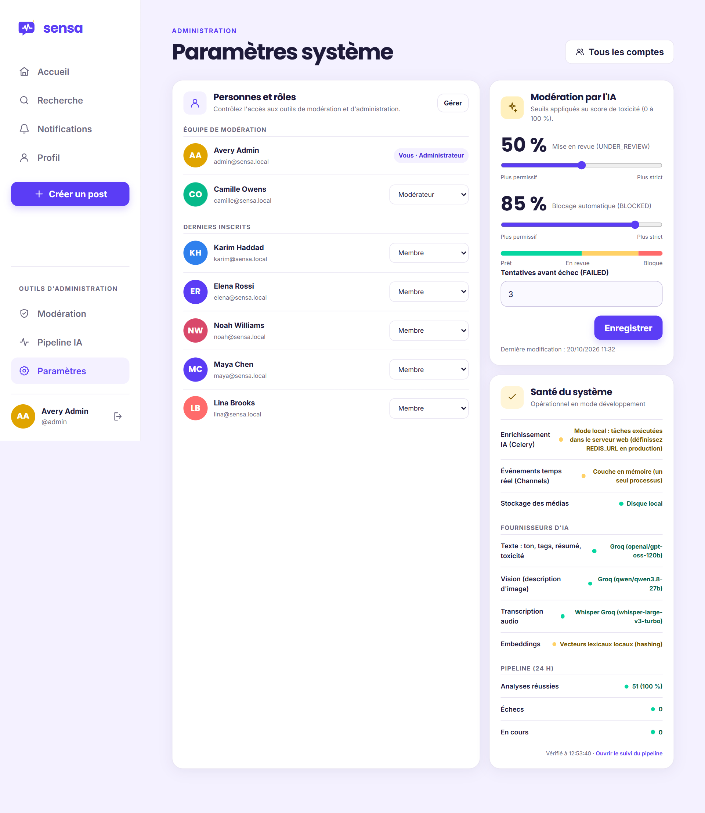

# Sensa — le réseau social où l'IA rend chaque contenu accessible

**Sensa** est un réseau social multimodal : une même publication réunit **texte, image et audio**.
Elle est mise en ligne instantanément, puis enrichie **en arrière-plan** par l'intelligence
artificielle : description des images pour les personnes malvoyantes, transcription des vocaux,
tags, résumé, modération automatique et recommandations personnalisées.

Projet universitaire 2026–2027 réalisé en équipe de cinq, en **Django 5 (architecture MVT)**,
avec Celery, Django Channels et l'API Groq (Whisper, gpt-oss, Qwen vision).

<p align="center">
  
</p>

## Fonctionnalités

- **Publier en texte, en image et en voix** : audio enregistré directement dans le navigateur (3 min max),
  images JPEG/PNG/WebP (10 Mo max), limite anti-spam de 10 posts par heure.
- **Accessibilité par défaut** : chaque image est décrite, chaque vocal est transcrit (segments horodatés,
  synchronisés avec le lecteur), export en sous-titres WebVTT/SRT, traduction fr/en/ar, résumé IA.
- **Publier sans attendre** : la publication prend moins d'une seconde ; l'IA travaille ensuite dans Celery et
  la carte du post se met à jour en temps réel (« Étape 2/6 · Transcription… »).
- **Communauté sûre** : score de toxicité sur le texte, l'image et l'audio ; mise en revue ou blocage
  automatique selon des seuils réglables ; avertissement « Restons bienveillants » avant un commentaire agressif ;
  signalements et file de modération triée par risque.
- **Social** : abonnements, j'aime, commentaires imbriqués analysés par l'IA, traduction à la demande des commentaires,
  suggestions IA pour répondre à un commentaire, résumé IA des conversations avec amorces de discussion,
  notifications instantanées (WebSocket).
- **Découverte** : fil chronologique, fil « Pour vous » expliqué (« Proche de … que vous avez aimé »),
  recherche plein texte jusque dans les transcriptions, recherche par le sens, hashtags et tendances.
- **Back-office** : gestion des comptes et des rôles, seuils IA, santé du système, tableau de bord du pipeline IA
  (taux de réussite, latences, jetons, cache, relances, journal des tentatives).

## Captures d'écran

| Fil « Pour vous » | Analyse en direct | Tableau de bord du pipeline IA |
|---|---|---|
|  |  |  |
| **File de modération** | **Paramètres système** | **Mobile** |
|  |  |  |

Le guide d'utilisation complet (33 pages illustrées) est disponible dans
[docs/Guide_utilisation_Sensa.pdf](docs/Guide_utilisation_Sensa.pdf).

## Stack technique

| Couche | Technologies |
|---|---|
| Web | Django 5.2 (MVT), gabarits Django, CSS et JavaScript sans framework |
| Temps réel | Django Channels + Daphne (WebSocket), Redis en production |
| Tâches asynchrones | Celery (files `ia_rapide` / `ia_lourde`) + Celery Beat, Redis |
| Données | SQLite en développement, PostgreSQL 16 (recherche plein texte, pgvector) en production |
| Médias | Disque local ou MinIO / S3 |
| IA | Groq : Whisper large v3 turbo, gpt-oss-120b, Qwen 3.8 vision ; second fournisseur Claude ; replis open source locaux |

## Équipe

| Module | Responsable | Application Django |
|---|---|---|
| Commun : authentification et utilisateurs | Toute l'équipe | `accounts` |
| 1. Publications | Hiba Chaabani | `publications` |
| 2. Interactions sociales | Med Nour Romdhani | `social` |
| 3. Enrichissement IA asynchrone | Haythem Djebbi | `enrichment` |
| 4. Modération et back-office | Chedly Rebai | `moderation` |
| 5. Fil, recherche et recommandations | Taieb Bel Hadj Ali | `feed` |

## Démarrage rapide

```bash
git clone https://github.com/haythem-djebbi9/Sensa.git
cd Sensa
python -m venv .venv
.venv\Scripts\pip install -r requirements.txt
copy .env.example .env          # puis renseignez GROQ_API_KEY
.venv\Scripts\python manage.py migrate
.venv\Scripts\python manage.py seed_demo
.venv\Scripts\python manage.py runserver
```

Ouvrez http://127.0.0.1:8000. `runserver` utilise Daphne (ASGI) : HTTP **et** WebSocket.
Sous macOS / Linux, remplacez `.venv\Scripts\` par `.venv/bin/` et `copy` par `cp`.

Comptes de démonstration (mot de passe `SensaDemo2026!`) :

| Compte | Rôle |
|---|---|
| `admin` | Administrateur (comptes, rôles, seuils IA) + accès à `/admin/` |
| `camille` | Modératrice (file de modération, suivi du pipeline IA) |
| `lina`, `maya`, `noah`, `elena`, `karim` | Membres |

D'autres comptes de test (un par rôle et un par membre de l'équipe) : `python manage.py create_test_accounts`
(voir [docs/comptes_de_test.md](docs/comptes_de_test.md)).

Sans configuration, tout fonctionne en local : SQLite, médias sur disque, couche Channels en
mémoire, **replis IA locaux** (voir plus bas) et Celery en mode *eager* : les tâches sont alors
exécutées dans un thread d'arrière-plan (`SENSA_ASYNC_DEV=1`), si bien que la publication reste
instantanée et que la carte du post se met à jour toute seule quand l'analyse se termine.

## Architecture : une app par module

| App | Module | Responsable | Modèles | IA (tâche Celery) |
|---|---|---|---|---|
| `accounts` | Commun : Auth et Users | toute l'équipe | `Membre`, `Moderateur`, `Administrateur` (héritage par proxy), `Profile` | — |
| `publications` | 1. Publications | Hiba Chaabani | `Publication`, `Image`, `Audio` | `describe_image(image_id)` → `Image.description_ia` |
| `social` | 2. Interactions sociales | Med Nour Romdhani | `Abonnement`, `Commentaire`, `Reaction`, `Notification` | `analyse_tone`, traduction des commentaires, résumé IA et amorces de conversation |
| `enrichment` | 3. Enrichissement IA asynchrone | Haythem Djebbi | `AnalyseIA`, `TentativeIA`, `CacheIA`, `PipelineConfig`, `Tag`, `PublicationTag` | `transcribe_audio`, `generate_tags`, `summarize_post`, `translate_transcription` + relances, cache, chien de garde |
| `moderation` | 4. Modération et back-office | Chedly Rebai | `Signalement`, `ConfigurationIA`, `DecisionModeration` | `score_toxicity(text, image_description, transcription)` |
| `feed` | 5. Fil, recherche, recommandations | Taieb Bel Hadj Ali | `Recherche` (+ `Publication.embedding`) | `embed_post(post_id)` → `Publication.embedding` |
| `core` | Socle | — | — | routeur des fournisseurs d'IA (Groq, Claude), texte, icônes, gabarits |

### Cycle de vie d'un post

```
Publication (PENDING) ──► description ─► transcription ─► tags ─► modération ─► embedding ──► finalize
                                                                                              │
         score < 0,5 → READY · 0,5 ≤ score < 0,85 → UNDER_REVIEW · ≥ 0,85 → BLOCKED           │
         une étape en échec après 3 tentatives → FAILED (post visible brut, relance possible) ◄┘
```

- Orchestration : `enrichment/pipeline.py` (`launch`, `advance`, `finalize`, `retry_failed`).
- Relances : `enrichment/runner.py` — 3 tentatives (10 s, 1 min, 5 min ; nombre réglable dans
  `ConfigurationIA.max_retries`), puis `FAILED`. Utilisé par **toutes** les tâches IA.
- `UNDER_REVIEW` et `BLOCKED` ne sont visibles que par l'auteur et les modérateurs.

## Besoins fonctionnels couverts (BF-01 → BF-20)

- **Comptes** : inscription avec e-mail de confirmation, connexion par e-mail ou pseudo,
  mot de passe oublié, profil (avatar, bio, centres d'intérêt), rôles Visiteur / Membre /
  Modérateur / Administrateur.
- **Publication** : texte (2 000 car.), image JPEG/PNG/WebP ≤ 10 Mo, audio ≤ 3 min enregistré
  **dans le navigateur** (MediaRecorder) ou importé, limite de 10 posts/heure (HTTP 429),
  modification / suppression, statut de l'analyse visible et rafraîchi automatiquement.
- **Social** : abonnements, j'aime, commentaires, avertissement *« Restons bienveillants »*
  avant un commentaire agressif, **notifications temps réel** (Django Channels / WebSocket),
  priorisées selon le ton.
- **IA et découverte** : description d'image (alt-text), transcription horodatée et
  synchronisée avec le lecteur, tags automatiques, fil « Pour vous » **expliqué**
  (« Proche de … que vous avez aimé ») avec 1 post sur 5 hors de vos abonnements,
  recherche plein texte (texte, transcriptions, tags, descriptions) et **recherche par le sens**.
- **Modération** : signalements (masquage auto après 3), file triée par score IA,
  approuver / bloquer / rejeter, métriques, réglage des seuils, gestion des comptes et rôles,
  santé du système, suivi du pipeline IA (`/ia/`) avec relance manuelle.

## Configurer l'IA

Copiez `.env.example` en `.env` et renseignez `GROQ_API_KEY` (le fichier `.env` est exclu de Git).
Un routeur (`core/ai/llm.py`) essaie les fournisseurs dans l'ordre `SENSA_AI_PROVIDERS=groq,claude`,
puis bascule sur les replis locaux.

| Tâche | Fournisseur principal (Groq) | Replis |
|---|---|---|
| Description d'image (module 1) | `qwen/qwen3.8-27b` (vision) | Claude → BLIP local → description basique |
| Ton, traduction des commentaires, résumé et amorces de conversation (module 2) | `openai/gpt-oss-120b` | Claude ; lexique FR/EN pour le ton |
| Transcription (module 3) | `whisper-large-v3-turbo` (langue + segments horodatés) | Whisper API OpenAI → faster-whisper / openai-whisper local |
| Tags, thème, langue (module 3) | `openai/gpt-oss-120b` (JSON par schéma) | Claude → mots-clés locaux |
| Résumé (module 3) | `openai/gpt-oss-120b` | Claude → extrait local |
| Traduction à la demande (module 3) | `openai/gpt-oss-120b` | Claude |
| Toxicité (module 4) | `openai/gpt-oss-120b` | Claude → Detoxify local → lexique FR/EN |
| Embeddings (module 5) | `sentence-transformers` local (multilingue) | vecteurs lexicaux par hachage |

Modèles locaux optionnels : `pip install -r requirements-ai-local.txt`.

## Module 3 en détail (Haythem Djebbi)

- **Pipeline en 6 étapes** (`enrichment/pipeline.py`) : description → transcription → tags/thème/langue →
  résumé → modération → embedding, puis statut final et notification de l'auteur. Étapes facultatives
  activables dans `PipelineConfig` (page *Pipeline IA*, administrateurs).
- **Relances** (`enrichment/runner.py`) : 3 tentatives (10 s, 1 min, 5 min), routeur Groq → Claude dans chaque
  tentative, modèles locaux à la dernière ; **journal des tentatives** (`TentativeIA` : fournisseur, modèle,
  latence, jetons, erreur) ; durée totale, modèle et jetons sur chaque `AnalyseIA`.
- **Cache par empreinte SHA-256 du média** (`CacheIA`) : un même fichier n'est analysé qu'une fois.
- **Progression en temps réel** : chaque étape est poussée à l'auteur par WebSocket (barre « Étape 2/6 »).
- **Chien de garde** (`enrichment/watchdog.py`) : relance les analyses bloquées, toutes les 5 min via Celery Beat.
- **Deux files Celery** : `ia_lourde` (audio, image, traduction) et `ia_rapide` (texte).
- **Accessibilité** : export de la transcription en sous-titres **WebVTT / SRT** ou texte, **traduction** fr/en/ar.
- **Tableau de bord** `/ia/` : réussite, latence moyenne et p95, jetons, cache, histogramme horaire, performance
  par étape, fournisseurs, détail de chaque analyse, *Relancer les échecs*, *Débloquer*.
- **Commandes** : `reenrich --failed | --all | --publication <uuid> [--types tags,summary]`,
  `pipeline_watchdog`, `pipeline_stats --hours 24`.

## Environnement « production » (PostgreSQL, Redis, MinIO)

```bash
docker compose up -d
```

Dans `.env` : `POSTGRES_DB=sensa`, `REDIS_URL=redis://localhost:6379/0`, `USE_MINIO=1`. Puis lancez
le serveur web **et** un worker Celery (sous Windows, `--pool=solo`) :

```bash
.venv\Scripts\celery -A sensa worker -Q ia_rapide,ia_lourde --pool=solo -l info
```

Et le planificateur (chien de garde toutes les 5 minutes) :

```bash
.venv\Scripts\celery -A sensa beat -l info
```

Avec PostgreSQL, la recherche par mots-clés utilise la recherche plein texte (`SearchVector`
français). Les embeddings sont stockés en JSON sur `Publication.embedding` ; pour passer à
**pgvector**, remplacez ce champ par `pgvector.django.VectorField` et la similarité Python par
`CosineDistance` dans `feed/services.py` (image Docker `pgvector/pgvector:pg16` déjà fournie).

## Guide d'utilisation

Le guide PDF illustré se trouve dans [docs/Guide_utilisation_Sensa.pdf](docs/Guide_utilisation_Sensa.pdf)
(captures d'écran dans `docs/captures/`).

## Tests

```bash
.venv\Scripts\python manage.py test
```

90 tests couvrent les six apps : rôles et permissions, validation des fichiers, limite de
publication, pipeline et relances (3 tentatives → FAILED), seuils de modération,
signalements, notifications WebSocket, recherche, recommandations et tout le module 3
(fournisseur Groq simulé, cache, journal des tentatives, chien de garde, sous-titres, traduction, tableau de bord). Les appels aux API
d'IA sont simulés : aucun test n'utilise le réseau.

## Arborescence

```
sensa/            configuration (settings, urls, asgi, celery)
core/             socle : client Claude, outils texte, balises de gabarit, seed_demo
accounts/         module commun
publications/     module 1
social/           module 2 (+ consumers.py, routing.py pour le WebSocket)
enrichment/       module 3 (pipeline.py, runner.py)
moderation/       module 4 (services.py = score_toxicity, health.py)
feed/             module 5 (services.py = fil, recherche, recommandations)
templates/        gabarits Django (layouts, partials, une page par écran de la maquette)
static/           sensa.css (design Figma porté sans Tailwind), sensa.js
```
